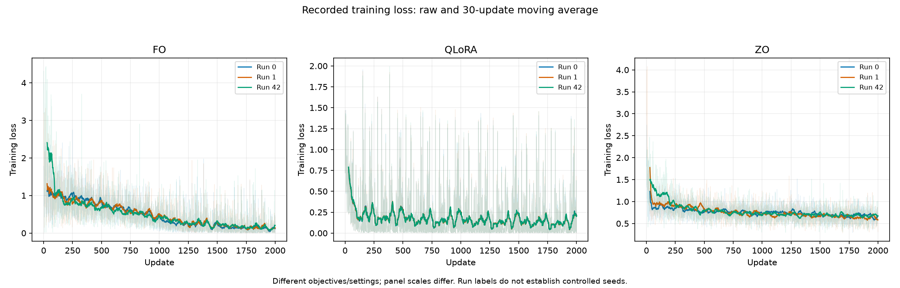
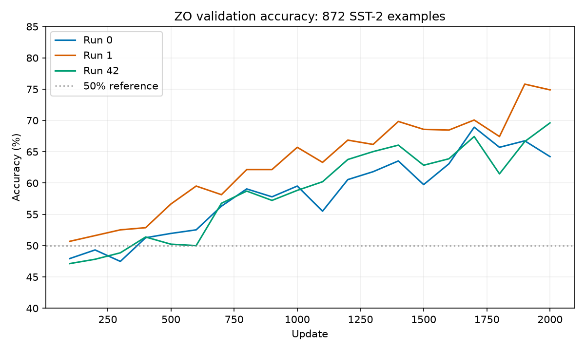

# Memory-constrained LLM fine-tuning on Intel integrated graphics

A preserved experimental study of first-order LoRA, 4-bit NF4 QLoRA and zeroth-order optimization using Qwen2.5-1.5B on an Intel Core Ultra 5 125H system with 16 GB RAM.

This research repository preserves original experiment code and recorded results, with runnable CPU analysis. Historical training environments and launch details are not fully reconstructable. No experiments were rerun during preparation. Separate 3B and 7B probes must not be represented as sustained training benchmarks.

Author: [Justin Marco](https://github.com/justinmrco). Academic scope: a configuration-specific empirical study, not a general hardware or method benchmark.

## Recorded results

| Workflow | Recorded runs | Updates/run | Final accuracy, mean +/- sample SD |
| --- | ---: | ---: | ---: |
| BF16 first-order classification | 3 | 2,000 | 96.00% +/- 1.00 percentage point |
| NF4 QLoRA | 3 | 2,000 | 94.00% +/- 1.00 percentage point |
| Zeroth-order classification | 3 | 2,000 | 69.57% +/- 5.33 percentage points |

The +/- values are **sample standard deviations across three recorded runs**, not confidence intervals. The optional verifier recomputes these values directly from saved records.

FO and QLoRA accuracy use 100 validation examples; ZO uses 872. Training subsets, objectives, adapters, batch sizes, sequence lengths and precision paths differ. These are descriptive workflow outcomes, not an isolated causal comparison or a general method ranking. FO/QLoRA seed labels are not proof of controlled random initialization.

The separate 3B result records one completed update. The subsequently supplied original testing folder contains a condensed 7B failure record, now copied to `evidence/7b/`. It reports OOM at model transfer before a forward pass, but is not a full stack trace. Its embedded interpretation overstates the boundary: the failed 64 MiB request is not proven to be the final required allocation. The saved allocation transcript describes cumulative allocations in one process, not a universal capacity ceiling.

## Inspect the evidence without a GPU

Python 3.11+ is sufficient for verification; no package installation, model download or network access is required. From the repository root:

```bash
python -B scripts/analyze_results.py
python -B tests/check_analysis.py
```

The first command verifies 52 evidence checksums and validates ten result records against their training CSVs, then prints accuracy, allocation and elapsed-time summaries. The second checks that modified files and truncated CSVs are rejected. Both are read-only for repository evidence. Paths resolve relative to the script location, so these commands also work when invoked by absolute path from another directory.

Optional CPU charts use Matplotlib:

```bash
python -m pip install -r requirements-analysis.txt
python -B scripts/plot_results.py
```

Plotting writes to `figures/generated/`, preserving historical figures. It does not run training or import the ML training modules. The analysis dependency pin records the version tested during preparation; it is separate from the historical training environments.



Loss panels use different vertical scales and objectives. They show recorded trajectories, not a shared loss benchmark.



## Evidence and interpretation

- [Experiment settings and evidence map](docs/EVIDENCE_MAP.md)
- [Reproduction instructions and limitations](docs/REPRODUCTION.md)
- [Publication verification and privacy review](docs/PUBLICATION_REVIEW.md)
- [Sources and redistribution notes](docs/REFERENCES.md)

## Layout

```text
src/                    Original training pipeline and optimizer
configs/                Historical YAML configurations
scripts/historical/     Original experiment, plotting and verification scripts
scripts/                New CPU-only evidence analysis and plotting commands
tests/                  Integrity regression check
results/                Selected result JSONs, training CSVs and diagnostics
figures/                Existing convergence and validation plots
environment/            Historical package snapshots
diagnostics/            Epsilon and allocation transcripts
evidence/               Recovered 7B failure record and Phase 1 source/CSV
docs/                   Provenance, evidence requests and interpretation limits
```

Adapters, repeated tokenizers, reference PDFs, thesis documents and handoffs remain in the local preservation archive. They are excluded from this candidate source repository. No license has been selected; source visibility does not establish rights to redistribute models, datasets or third-party publications.

## Before running anything

Read [reproduction notes](docs/REPRODUCTION.md). Several scripts retain original workspace paths and can start training, write results or allocate XPU memory immediately when executed. They are historical experiment programs, not a safe automated test suite. Model and dataset revisions are not consistently immutable, and environment snapshots are not per-run environment proofs.

New work verifies saved-data consistency and analysis behavior only. No new trained-model accuracy, training runtime or hardware-validation result is claimed. Do not fix historical code silently and then describe old outputs as results of the modified implementation.

The original testing folder has been received and preserved privately; see [evidence coverage](docs/EVIDENCE_NEEDED.md). Additional exact launch logs and immutable environment records would improve training reproducibility, but no new experiments are required to inspect the published evidence. The CI workflow checks saved evidence only; a GitHub-hosted run has not yet been observed.
